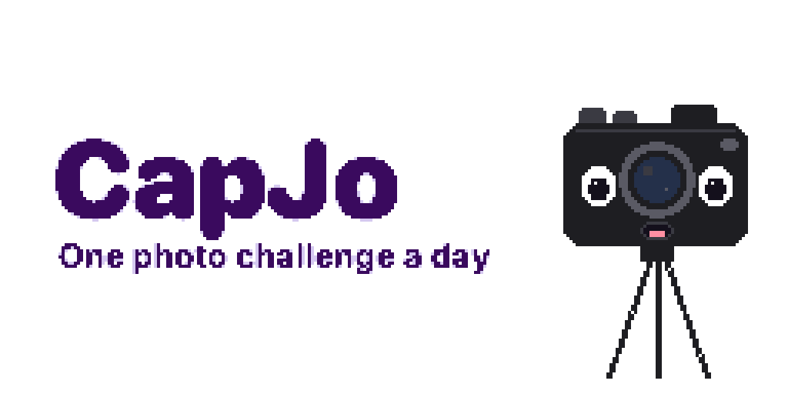
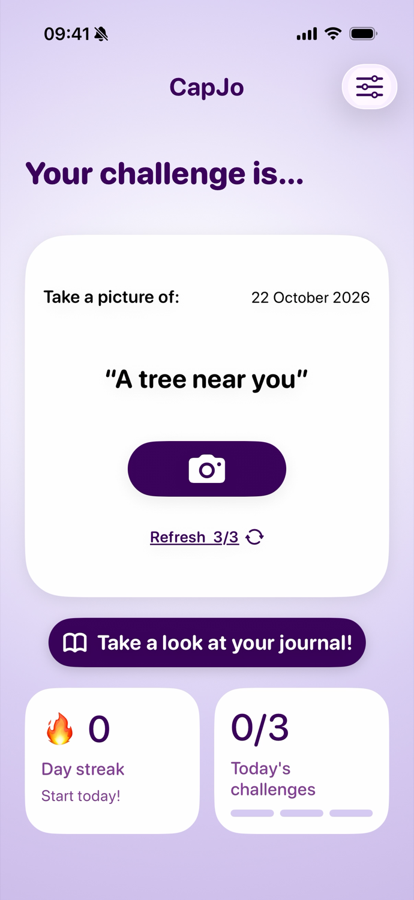
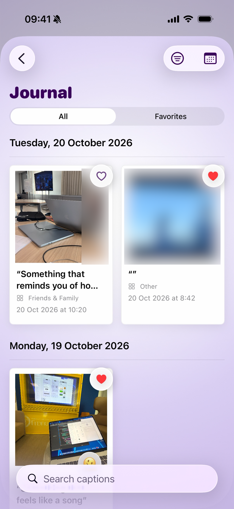
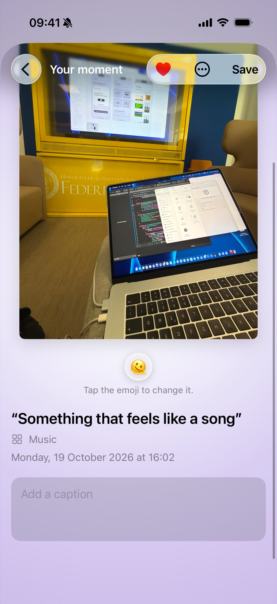
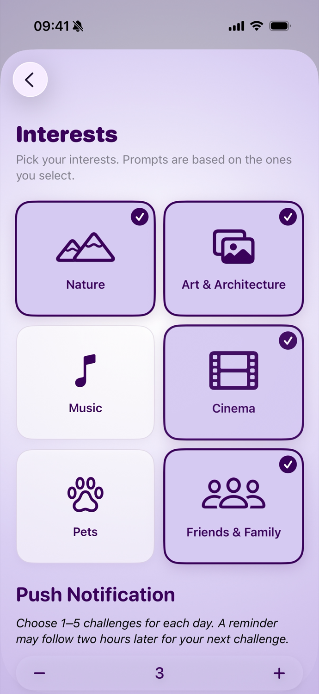
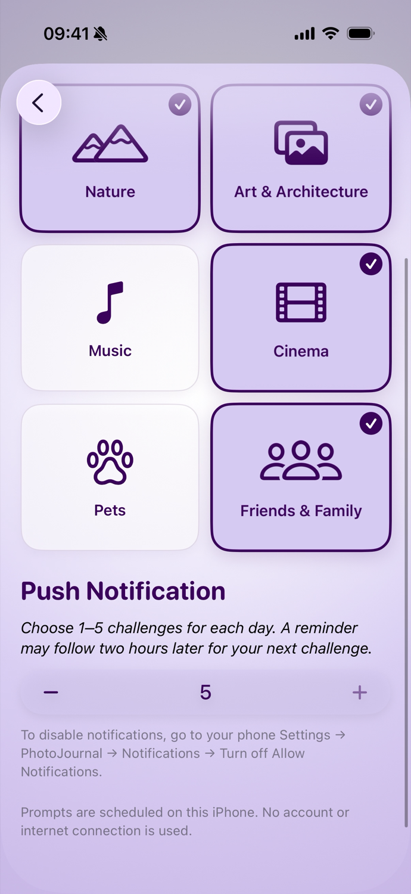

# CapJo: A Photo Challenge Journal

**One photo challenge a day.** CapJo gives you a small thing to photograph, like "A tree near you" or "A color you love", picked from the interests you choose. You take the picture in the app, add an emoji and a caption, and it goes into a journal of polaroids, grouped by day. Reminders arrive at random times during the day, and a streak counts the days in a row you kept up.

<p align="center">
  
  
  
  
  
</p>

- **Platforms:** iPhone, iOS 18.0+
- **Language:** Swift with SwiftUI, plus a UIKit camera. No third-party dependencies.
- **Privacy:** photos and entries stay on the iPhone. No account, no network.
- **Status:** a working app, made with my team at the Apple Developer Academy (see [Status](#status-what-is-verified-and-what-isnt)).

---

## Contents

1. [What it does](#what-it-does)
2. [How it works](#how-it-works)
3. [Design](#design)
4. [Privacy](#privacy)
5. [Technologies](#technologies)
6. [Project structure](#project-structure)
7. [Build and run](#build-and-run)
8. [Status: what is verified and what isn't](#status-what-is-verified-and-what-isnt)

---

## What it does

1. **Pick your interests.** Nature, Art & Architecture, Music, Cinema, Pets, and Friends & Family. Prompts come only from the ones you select.
2. **Get a challenge.** Home shows today's prompt, like "A tree near you". Don't like it? **Refresh** gives you another one, up to three times a day.
3. **Take the picture.** The camera opens inside the app, with 0.5×, 1× and 2× zoom and a flash button.
4. **Save the moment.** Add an emoji and a caption. Turn on **Also save to Photos** if you want a copy in your library too.
5. **Look back.** The journal shows every photo as a polaroid, newest first, grouped by day.

Also:

- **Daily goal.** Choose 1 to 5 challenges a day. Home shows how many you've done, for example "0/3".
- **Day streak.** Counts the days in a row with at least one photo.
- **Journal tools.** All or Favorites, filter by category, jump to a date, and search captions.
- **Edit later.** Change the emoji or caption, mark a favorite, save to Photos, or delete a photo.

---

## How it works

### Entries (`PhotoJournal/Models/JournalModels.swift`)

Each photo is a `JournalEntry`: date, prompt, category, caption, emoji, favorite flag and the file name of its image. `JournalStore` keeps the list in memory and writes it to `journal.json` in the app's Documents folder. Images are saved next to it in `JournalPhotos/` as JPEGs at 85% quality. Older entries that stored a mood word ("Joyful", "Calm"…) are converted to an emoji when they load.

### Prompts (`PromptCategory`)

Every category has its own short list of prompts. The daily prompt and its refreshes are drawn from the categories you picked in Interests.

### Reminders (`PhotoJournal/Services/PromptNotifications.swift`)

For each day, the app picks as many random times between 9:00 and 19:00 as your daily goal and schedules a local notification for each one. If a challenge is still open, a follow-up can arrive two hours after the last prompt. Taking a photo cancels that day's follow-up.

### Camera (`PhotoJournal/Camera/CameraPicker.swift`)

A custom `AVFoundation` camera wrapped for SwiftUI, with lens zoom presets and a flash toggle. On a device without a camera (like the simulator) the app says so instead of opening it.

---

## Design

- **Colours:** deep purple and lavender, taken from the app icon's viewfinder corners.
- **Polaroids:** every journal photo is a white card with the prompt underneath, like an instant photo.
- **Background:** a slow, animated purple gradient behind every screen.
- **Mascot:** a camera with big eyes, in the app's assets and in the banner above.
- **Emoji:** one emoji per photo, picked from a full emoji catalog with a search.

---

## Privacy

- Photos and entries are stored only in the app's own folder on the iPhone.
- Photos access is requested only if you turn on **Also save to Photos**.
- Reminders are scheduled on the iPhone. There is no account, no server and no analytics.

---

## Technologies

| Area | Frameworks and techniques |
| --- | --- |
| Language | Swift, main-actor default isolation with Approachable Concurrency |
| UI | SwiftUI, animated gradient background, custom cards and sheets |
| Camera | AVFoundation capture session in a `UIViewControllerRepresentable` |
| Storage | JSON file plus JPEGs in Documents, `ObservableObject` store |
| Photos | Photos framework, add-only saving |
| Reminders | UserNotifications, calendar triggers at random times |

---

## Project structure

```
CapJo/
├── PhotoJournal/
│   ├── Keep/              App entry point
│   ├── Models/            Journal entries, store, prompt categories
│   ├── Views/             Home, journal, entry detail, review and settings
│   ├── Camera/            The in-app camera
│   ├── Services/          Reminders and saving to Photos
│   ├── EmojiCatalog.swift Every emoji with its name, for the picker
│   └── Assets.xcassets    App icon and the camera mascot
├── PhotoJournal.xcodeproj
└── .github/               Banner and README screenshots
```

---

## Build and run

Requirements: Xcode 27 on macOS. Open `PhotoJournal.xcodeproj`, pick the **PhotoJournal** scheme and run on an iPhone. Signing uses your own team.

From the command line:

```bash
xcodebuild build -project PhotoJournal.xcodeproj -scheme PhotoJournal -destination 'generic/platform=iOS Simulator' CODE_SIGNING_ALLOWED=NO
```

The simulator has no camera, so taking photos needs a real iPhone.

---

## Status: what is verified and what isn't

**Verified**

- Builds for the iOS simulator with no errors.
- The screenshots are frames from a screen recording of the app running on an iPhone. One photo in the journal is blurred because it shows people.

**Not verified yet**

- There is no unit test target.
- Reminder timing was not checked across several days for this README.

---

© 2026 Alessandro Signorile. All rights reserved.
